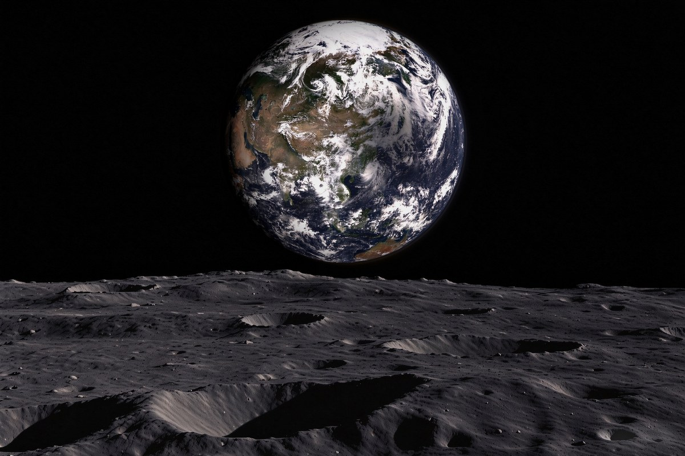
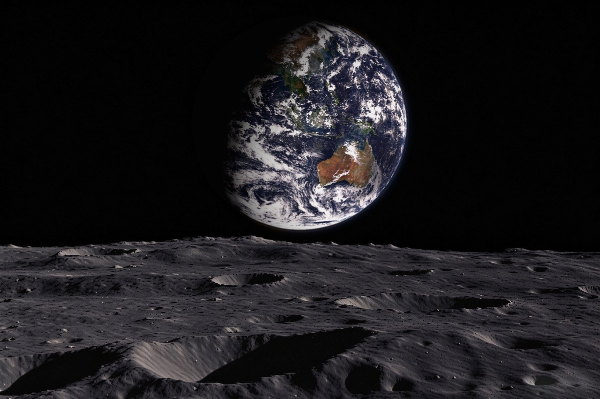
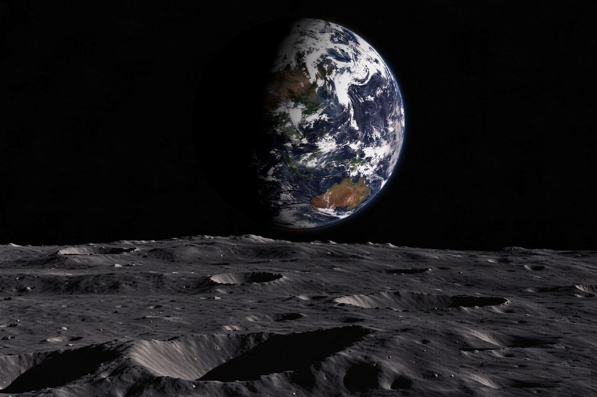
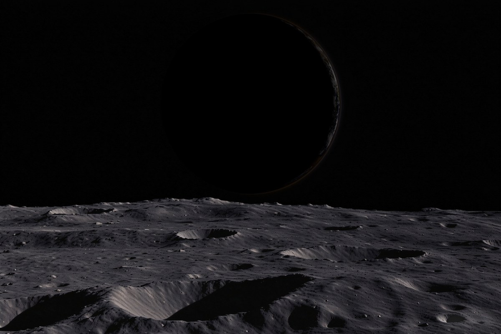

# 地相图 / 地球相 —— 从月球视角还原真实地球

给定一个日期，生成 **从月球看到的真实地球**，并排成「地出式」月面海报。

- 视角 = **月下点**（sublunar point），不是随便挑角度
- 相位由星历逐日计算
- 纹理来自 NASA GIBS（Terra / Aqua / VIIRS 三源）
- 光照在最后一步按物理施加（朗伯余弦 + 暮光 + 大气弧）

> **本项目必须配合「豆包」使用。**
> 豆包负责三道工序：擦掉拼接黑线、清除薄雾条带、提清晰度。
> 没有豆包，成图会保留明显的拼接瑕疵，**不构成可用成品**。

---

## 成品长什么样

1920×1280 两张：

| 文件 | 说明 |
|---|---|
| `<日期>_月面_1920x1280.png` | 基础版 |
| `<日期>_月面_提升_1920x1280.png` | 豆包提清晰度版 |

### 样例（都是实际输出，未经二次修饰）

| 96% 相位 · 中国几乎正中 | 76% 相位 |
|---|---|
|  |  |

| 63% 相位 | 2% 相位 · 极细月牙 |
|---|---|
|  |  |

> 相位从 96% 到 2%，都是**真实星历算出来的**，没有一张是"摆拍"。
> 2% 那张暗到几乎看不见——这是天文事实，我们不美化。

---

## 前置条件

### 1. Windows + Python 3.9+

```bash
pip install -r requirements.txt
```

依赖只有两个：`numpy`、`Pillow`。星历是项目自己算的，不需要额外库。

### 2. 豆包（必需）

1. 到官网下载并安装豆包（Windows 客户端）
2. **找到它的主程序路径**：装完后在安装目录里找
   ```
   <安装目录>\Doubao\app\Doubao.exe
   ```
   注意是子目录 `app\` 里的那个 `Doubao.exe`，**不是**上一级的启动器。

3. 用**带调试端口**的方式启动它（每次跑图前确认它在运行）：

   ```powershell
   Start-Process "<你的路径>\Doubao\app\Doubao.exe" -ArgumentList "--remote-debugging-port=9225"
   ```

   > 如果豆包已经在运行，这样启动**不会**带端口。
   > 先完全退出（任务管理器结束所有 `Doubao.exe`），再用上面的命令启动。

4. 验证端口是否通：

   ```powershell
   Invoke-WebRequest http://127.0.0.1:9225/json/version
   ```
   能返回 JSON 就对了。

### 3. Node.js（豆包驱动需要）

本项目用几个 `.mjs` 脚本通过 CDP 协议操作豆包窗口，**需要 Node.js 18 以上**。

```bash
node --version    # 需要 v18+
```

> **不需要 `npm install`。**
> 这些脚本只用了 Node 内置模块（`node:fs` / `node:path` / `node:child_process`），
> 依赖已随仓库内置于 `tools/lib/`，没有第三方 npm 包。

若 `node` 不在 PATH 里，可以用环境变量指定：

```bash
set DSH_NODE=C:\Program Files\nodejs\node.exe
```

### 4. 告诉程序豆包在哪

三种方式，任选一种：

| 方式 | 做法 |
|---|---|
| **自动探测**（多数情况够用） | 装在常见位置就不用管 |
| **config.json** | 复制 `config.example.json` 为 `config.json`，填 `doubao_exe` |
| **环境变量** | `set DSH_DOUBAO_EXE=<路径>` |

检查是否识别到：

```bash
python config.py
```

会打印当前用的路径、端口，以及可以直接复制的启动命令。

---

## 用 AI 助手驱动（可选）

仓库里带了 `AGENTS.md`——它是写给 AI 助手看的操作规程。

如果你用支持 `AGENTS.md` 的助手（例如 DeepSeek Harness、Claude Code 等）打开本项目，
可以直接说：

> 帮我出 2009 年 6 月 21 日那张图

助手会按 `AGENTS.md` 自动：检查豆包端口 → `check` 确认中国在亮部 → 跑主流程 → `verify` → 汇报。

**不用 AI 也完全能跑**，就是上面的命令行方式；AI 只是省掉你记流程。

---

## 用法

```bash
run.cmd 2009-06-21
```

约 3 分钟，产出两张图到 `成品\`。

其它模式：

| 命令 | 说明 |
|---|---|
| `run.cmd <日期> check` | 只算视角、确认中国在亮部（0.3 秒，不取图） |
| `run.cmd <日期> noboost` | 跳过提清晰度 |
| `run.cmd <日期> keep-tmp` | 保留中间产物（排障用） |
| `run.cmd <日期> legacy` | 旧流程（先打光，只产地球相） |
| `verify.cmd <日期>` | **交付前必须跑**，PASS 才算成品 |

---

## 硬规则

1. **只要亮部存在，中国必须在亮部** —— 程序会自动挑 UTC 满足它
2. **视角必须是月下点** —— 不许为了好看挪角度
3. **真实优先** —— 宁可相位难看（比如 2%），也不美化
4. **豆包失败就中止** —— 绝不拿带黑线的渲染图充成品
5. **地球永远正北朝上** —— 不许为了对齐光照去转它

---

## 常见问题

**Q：为什么一定要豆包？我自己用别的修图软件行不行？**
可以，但要满足三道：擦黑线、清薄雾、提清晰度，且**不许改整体亮度和云系结构**。
豆包的提示词我们是逐句调过的（见 `doubao_boost.py` 里的 `PROMPT_BOOST`），
换工具要自己重新调。

**Q：豆包提示「暂时无法生成」怎么办？**
它偶发拒绝。程序会自动：删掉这个对话 → 开新对话 → 重试，最多 4 次。

**Q：跑完 `成品\` 里怎么只有一张？**
可能是中途被中断了。重新跑，或者看 `v2\` 里的中间产物。

**Q：能改地球在画面里的位置/大小吗？**
能，但它是全局参数，改了所有日期都会变。见 `layout.py` 与 `compose_moon.py` 的 `--earth-pct`。

---

## 目录结构

```
地球\
├─ run.cmd / verify.cmd    一键入口
├─ make_earth_full.py      主流水线
├─ render_earth.py         正交投影渲染
├─ find_seams.py           接缝检测
├─ fill_gaps*.py           补洞
├─ compose_moon.py         月面版式合成
├─ lighting.py             按星历打光（最后一步）
├─ doubao_*.py             豆包驱动
├─ config.py               路径配置（换电脑只改这里）
├─ 素材\                   月面底图 + 参考图
├─ 成品\                   交付物
└─ v2\                     中间产物（可随时删）
```

---

## 授权

代码 MIT。`素材\` 里的月面底图是 AI 生成素材，**不对应真实月面地点**，
对外使用请自行声明；如需完全真实，请替换为你自己的月面正射影像。

---

## 上传到 GitHub

仓库已经配好 `.gitignore`（排除 `成品/`、`v2/`、`中转站/`、`config.json`、`python.txt`），
直接按下面做即可。

```bash
# 1. 在项目目录初始化
cd E:\DeskTop\地球
git init
git add .
git commit -m "feat: 地相图生成器（从月球视角还原真实地球）"

# 2. 关联远程仓库（先在 GitHub 上建一个空仓库，不要勾选 README）
git branch -M main
git remote add origin https://github.com/<你的用户名>/<仓库名>.git

# 3. 推送
git push -u origin main
```

### 提交前建议自查

```bash
git status --short        # 确认没有 成品/ v2/ 中转站/ 被加进来
git ls-files | findstr config.json     # 应该没有输出
```

### 仓库里会包含什么

| 会提交 | 不会提交（已忽略） |
|---|---|
| 全部 `.py` / `.mjs` / `.cmd` | `成品\`（74 MB 交付图） |
| `README.md`、`LICENSE`、`requirements.txt` | `v2\`（中间产物） |
| `docs\`（4 张样例，630 KB） | `中转站\` |
| `素材\`（月面底图，5.7 MB） | `config.json`、`python.txt`（本机路径） |

> `素材\` 会随仓库公开。如果你不想公开里面的 AI 生成底图，
> 把 `素材/` 加进 `.gitignore`，并在 README 里说明使用者需自备月面图。
